# IS401-Todo-List

## App Summary
Students often struggle to manage assignments and deadlines across multiple courses and platforms. **Coursewise** is a student-focused task management app designed to organize coursework, manage tasks, and keep track of changing deadlines. The application combines a daily overview, interactive to-do lists, a calendar, friends, streaks, and Canvas assignment importing into one platform. Its main goal is to simplify assignment tracking while keeping the experience easy to use. Students can organize school and personal responsibilities in one place, customize their workspace, and encourage each other to stay on track.

## Entity-Relationship Diagram

## Tech Stack
- **Frontend:** Built using HTML, CSS, and JavaScript.
- **Backend & Database:** Supabase handles authentication, persistent application data, and backend functions.
- **Hosting:** GitHub Pages hosts the website and allows easy access.
- **Integrations:** Canvas calendar feeds supply assignment and event information. An optional Gemini-powered review suggests which items to import.
- **Why this approach:** We used this tech stack because of its familiarity from other projects, manageable setup, and ability to support our app's features.

## How to Get It Running
1. Navigate to the website URL: https://jonathonfernelius.github.io/IS401-Todo-List/index.html
2. If you already have an account, log in using your email and password.
3. If you don't have an account, click **Create an Account**.
4. Fill out the required information on the signup screen and create your account.
5. Once signed in, you will be taken to the **Today** page.
6. Use the navigation bar to switch between **Today**, **To-do**, **Calendar**, and **Profile**.
7. You can also use the **Friends** icon in the top bar to connect with other students. Authorized admins have access to an additional admin screen, including a **Whimsy ideas** view of member theme suggestions.
8. Account data and tasks are stored in Supabase so they remain available when you sign in again.

## Screens and Features
The screenshots below show the current desktop interface and selected feature panels. Some interface elements and colors change based on account settings.

### Login, Sign Up, and Password Reset
The login screen is the starting point of the application. Returning users can sign in with their email and password, and new users can create an account. A password reset screen is also available to help users regain access or set a new password when needed.

**Today dashboard**

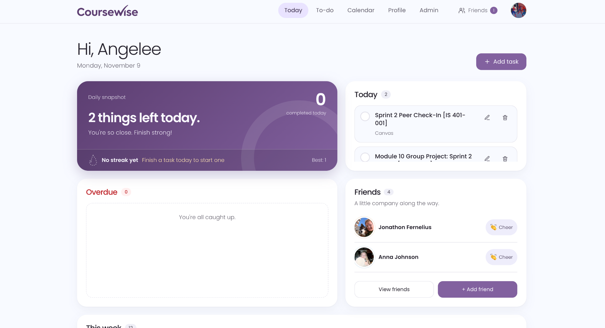

*Figure 1: The Today screen brings daily progress, upcoming work, and friends into one dashboard.*

### Today Screen
The Today page is the main dashboard and gives users a quick overview of their day.
1. **Daily snapshot:** Displays how many tasks are left today, a short encouraging message, and how many tasks have been completed today.
2. **Streak:** Shows current task-completion streak progress and reminds users when they need to finish a task to continue it.
3. **Today:** Lists tasks due today, with controls to mark tasks complete or manage them.
4. **Friends:** Sits beside the snapshot with a compact list where users can visit friends' profiles, send cheers, and open their friend list.
5. **Overdue:** Shows unfinished tasks with deadlines that have already passed.
6. **This week:** Displays a seven-day overview with task counts, a small visual chart, and an agenda that can be grouped **By day** or **By list**.
7. **Add task:** Allows users to create a task without leaving the dashboard.
8. **Getting started guide:** New accounts see three setup steps at the top of Today (connect Canvas, add a first task, add a friend). Each step checks itself off when it's done, Canvas and friends can be skipped, and the guide can be closed or brought back from **Profile → Preferences**. Run `supabase/migrations/20261111000000_intro_guide.sql` so the guide is remembered across devices.
9. **Canvas reminder:** If Canvas is not connected, the dashboard can display a reminder linking to the connection setup. When Canvas is connected, a banner appears if there are new items to review, and a small card confirms when due dates were synced.

**To-do lists**

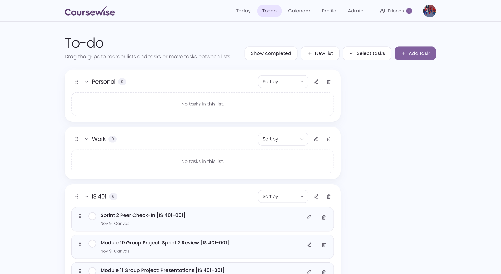

*Figure 2: Tasks are grouped into customizable lists with sorting and drag-and-drop controls.*

### To-do Screen
The To-do page is where users organize and manage their tasks in lists.
1. Create lists for classes, work, personal responsibilities, or anything else.
2. Add tasks to a list and expand or collapse lists to keep the page organized.
3. Rename and delete lists when they are no longer needed.
4. Rearrange lists and tasks using drag-and-drop. Tasks can also be moved between lists.
5. Sort individual lists by **Custom order**, **Alphabetically**, **Due date**, **Recently added**, or **Category**, and reverse the selected sort order.
6. View tasks without a valid assigned list in the **Unassigned** section.
7. Edit, complete, or delete tasks directly from the page.
8. Use task multi-selection to perform bulk complete or delete actions.
9. Show or hide completed tasks using the saved account preference.

**Monthly calendar**

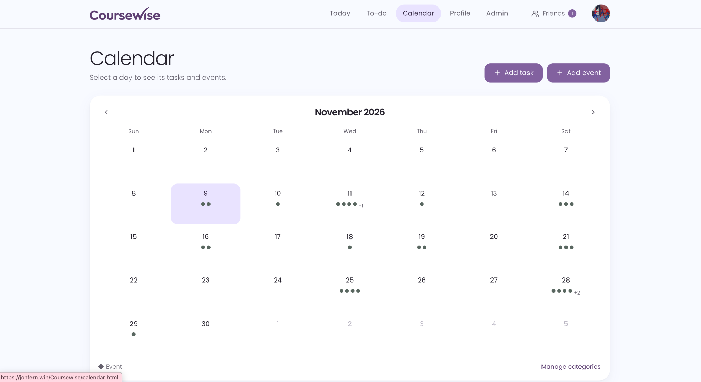

*Figure 3: The calendar highlights days with scheduled tasks and events.*

### Calendar Screen
The Calendar screen gives users a visual view of deadlines and other scheduled events.
1. Navigate between months using the calendar arrows.
2. View colored indicators for tasks and events on each date.
3. Select any day to see its scheduled tasks and events.
4. Add, edit, and complete tasks from the calendar.
5. Use **Add event** to create calendar events separately from tasks. Events can have a category and optional start and end times.
6. Set repeating events to daily, weekdays, weekly, monthly, or a custom schedule, with an optional end condition.
7. View sections for **Today's tasks**, **Other tasks** without due dates, and **Upcoming events** covering today and the next six days (up to 25 displayed).
8. Manage task/event categories using the calendar's category management control.

**Friends panel**

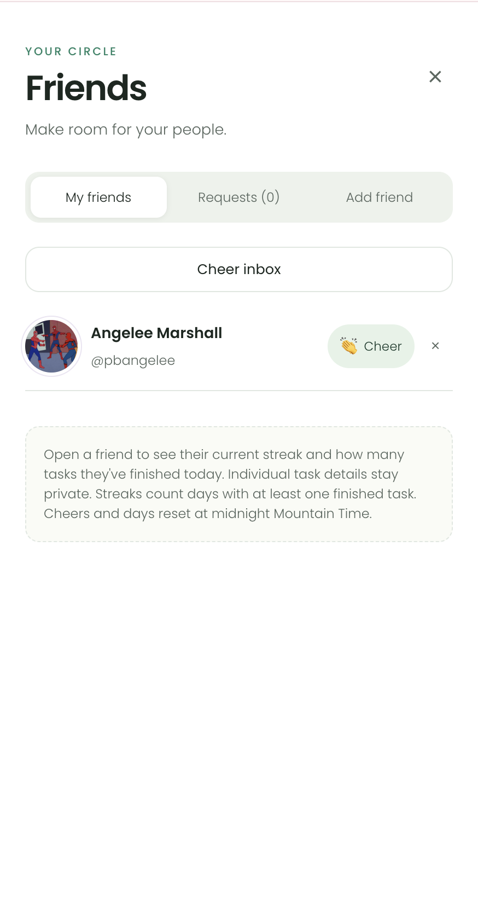

*Figure 4: Friends can manage their connections and send cheers without seeing each other's private tasks.*

### Friends Screen / Friends Panel
Friends is an interactive feature accessed from the main app and the Today page rather than a separate top-level navigation page.
1. Search for other users and send friend requests.
2. Accept, decline, or cancel pending requests, and remove friends when needed.
3. View your friends list and open an individual friend's details.
4. View a friend's profile photo, streak information, and available task-completion activity without revealing the titles of their private tasks.
5. Tap a friend's photo to enlarge it when a profile photo is available.
6. Send a **Cheer** to encourage a friend. Friends can also receive cheer notifications.

**Streaks and customization**

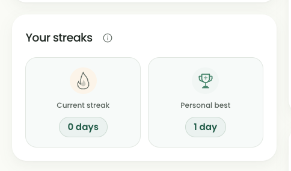

*Figure 5: The Profile screen tracks current and personal-best streaks.*

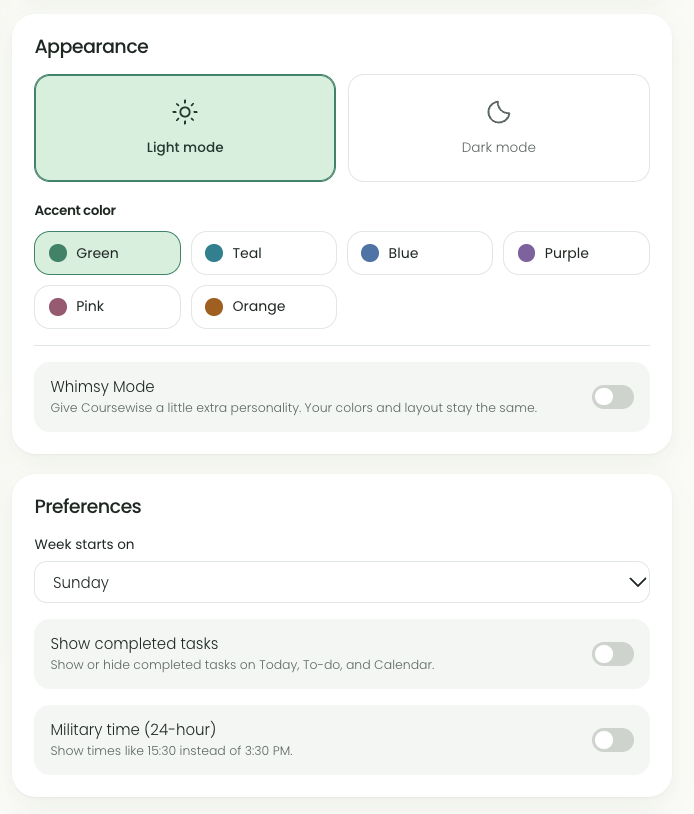

*Figure 6: Users can choose light or dark mode, an accent color, Whimsy Mode, and other preferences.*

### Profile Screen
The Profile screen is where users manage their account and personal settings.
1. **Profile photo:** Upload, change, remove, or enlarge a profile photo. Supported image formats include JPG, PNG, and WebP.
2. **Canvas:** Connect Canvas, check its connection, review available assignments and calendar items, import chosen items, or disconnect.
3. **Your streaks:** View the current streak and personal-best streak. Completing a task on consecutive days builds a streak; the app uses Mountain Time when determining the day.
4. **Account:** Update your first name, last name, and username. Your account email is shown as your sign-in email.
5. **Appearance:** Choose light or dark mode, an accent color theme, and optional Whimsy Mode. A suggestion box lets users send ideas for new whimsy themes.
6. **Preferences:** Choose whether weeks begin on Sunday or Monday, whether completed tasks are displayed, and whether times use 12-hour or 24-hour formatting.
7. **Categories:** Create and edit categories and their colors to organize tasks.
8. **Password:** Change your account password.
9. **Log out / Delete account:** Sign out or, after confirmation, permanently delete the account and associated Coursewise data.

**Connecting Canvas**

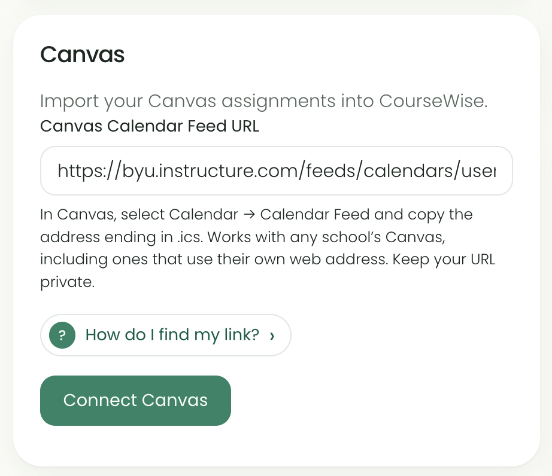

*Figure 7: Users enter a private Canvas calendar feed URL to connect their course calendar.*

**Connected account**

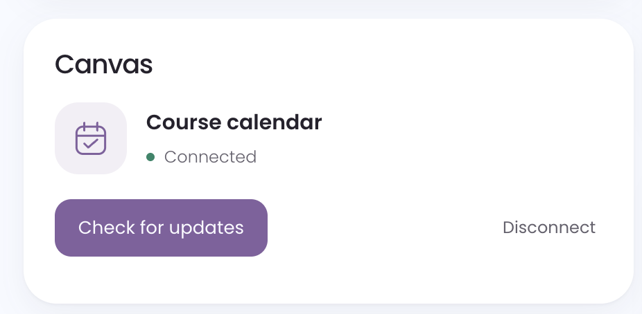

*Figure 8: Once connected, users can check for updates to their Canvas calendar.*

**Choosing an import method**

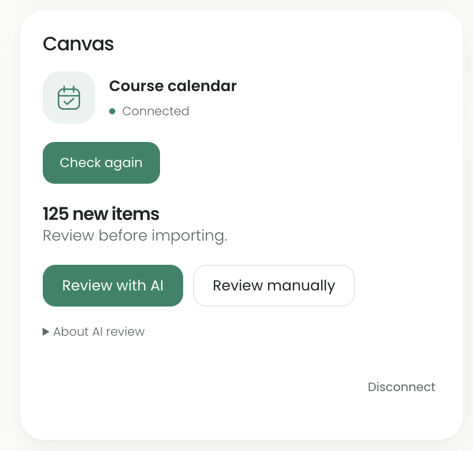

*Figure 9: New items can be reviewed with AI or selected manually before importing.*

**AI review in progress**

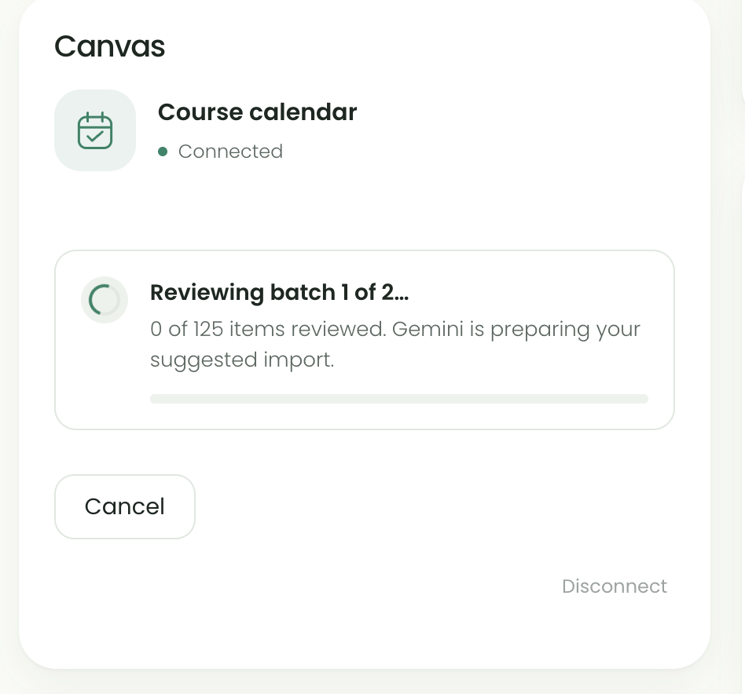

*Figure 10: The progress view shows Gemini reviewing batches of assignments.*

**Confirming selected assignments**

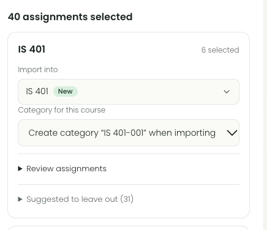

*Figure 11: Users can review selections by course and choose the destination list and category before import.*

### Canvas Connection and Import Screen
Canvas integration is accessed through the Canvas section of **Profile**. It allows students to bring course assignments and other calendar items into Coursewise.
1. Follow the guided connection process to connect a supported Canvas school calendar.
2. Retrieve available calendar information and choose **Review with AI** or **Review manually**.
3. AI review is optional and runs only when the user chooses it; it is not automatically triggered on connection or page load.
4. Review items grouped by course, select the ones you want, and edit their destination lists and optional categories.
5. Existing course lists can be matched by name, and missing lists can be created when the import is confirmed.
6. Older items and calendar events begin unselected; users can change selections before importing.
7. Imported items are checked to reduce duplicates, while previously imported deadlines can be synchronized when Canvas is checked again.
8. Loading and import states show progress. If AI review fails, users can still select and import items manually.

**Admin OKR tracker**

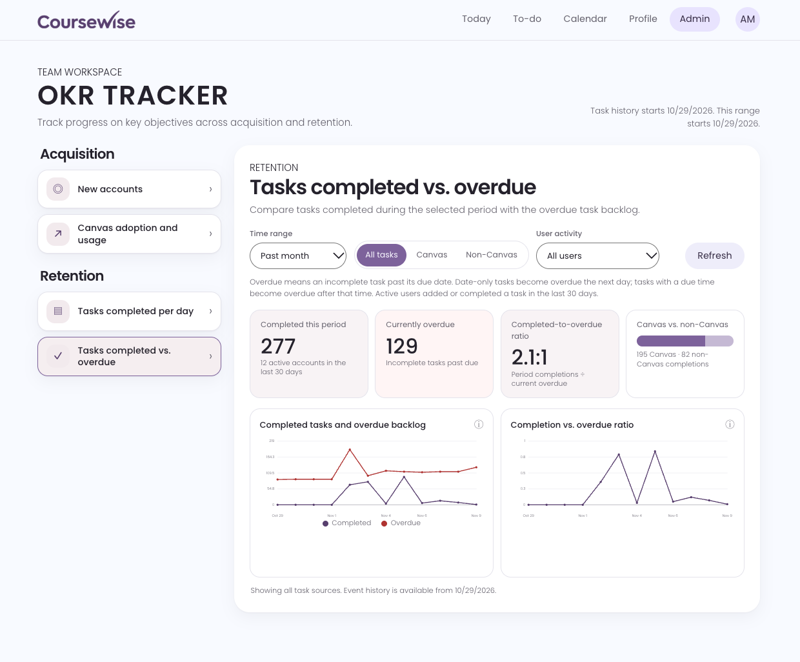

*Figure 12: The admin dashboard tracks acquisition, retention, and task completion performance.*

### Admin Screen
The Admin screen is intended for authorized administrators and provides an overview of application usage.
1. View the **OKR Tracker** dashboard with acquisition and retention metrics.
2. Review the number of registered users and growth in account creation.
3. View task completion trends, overdue tasks, and completion-to-overdue comparisons.
4. Examine daily completion activity and the share of accounts completing tasks.
5. Review metrics related to Canvas importing and assignment completion.
6. Use **Refresh** to update dashboard information.

## Adding Tasks
1. Click **Add task** from the Today, To-do, or Calendar page.
2. Enter the name of the task.
3. Assign it to a list, such as a course, Work, or Personal. Create additional lists as needed.
4. Optionally assign a category, such as Homework, Projects, or another user-defined category.
5. Set a due date and, if needed, a specific due time.
6. Choose whether the task repeats and select the recurrence settings if applicable.
7. Save the task.
8. The task can now appear on the Today, To-do, and Calendar pages according to its date and list.
9. Mark the task complete when finished. Completing tasks also contributes to daily completion counts and streaks.

## Calendar Events
Use **Add event** on the Calendar page to create a dated event with an optional start time, end time, category, and repeat rule. Events appear on the calendar and in their day's details, but are stored separately from tasks and do not appear in the to-do lists. The Upcoming events section shows events for today and the next six days. The event form includes a reserved notification control; **event notifications are not enabled yet**.

## Database Setup and Migrations
The application uses Supabase for persistent data. Existing projects should have the appropriate migrations applied before using features that depend on them. Run only migrations that have not already been applied, in chronological order, using the Supabase SQL Editor.

- `supabase/migrations/20261027000000_list_sort_order.sql` — persistent list ordering.
- `supabase/migrations/20261027010000_task_sort_order.sql` — persistent task ordering and movement between lists.
- `supabase/migrations/20261104000000_streaks.sql` — task streaks and friend-related day calculations.
- `supabase/migrations/20261105000000_profile_photos.sql` — profile photo support.
- `supabase/migrations/20261105010000_appearance_setting.sql` — appearance preference support.
- `supabase/migrations/20261105020000_time_format_setting.sql` — time format preference.
- `supabase/migrations/20261107000000_task_created_at.sql` — task creation timestamps for sorting.
- `supabase/migrations/20261107010000_persistent_streak_best.sql` — saved personal-best streak.
- `supabase/migrations/20261109000000_calendar_events.sql` — calendar event storage.
- `supabase/migrations/20261109010000_calendar_event_recurrence.sql` — repeating calendar events.
- `supabase/migrations/20261109020000_calendar_event_end_time.sql` — event end times.

Other Supabase functions and setup requirements are documented in the accompanying setup files, including `ADMIN-SETUP.md`, `PROFILE-PHOTOS-SETUP.md`, `CANVAS-IMPORT-SETUP.md`, and `CANVAS-ANY-SCHOOL.md`.

## Canvas AI Setup
If AI review is enabled, store `GEMINI_API_KEY` and a supported `GEMINI_MODEL` as **Supabase Function secrets** and deploy `supabase/functions/canvas-ai-suggestions/index.ts`. Do not put the Gemini API key in browser JavaScript. AI reviews send limited assignment/calendar information for suggestions; usage quotas and provider limits still apply. See `CANVAS-IMPORT-SETUP.md` for the complete guided import and deployment process.

## Verifying the Vertical Slice
To verify that the account creation vertical slice is working:
1. Open the website.
2. Click the signup option and create an account.
3. Enter the required information and submit the form.
4. Confirm that account creation succeeds and the Today page loads.
5. Refresh the page and verify that the user remains signed in.
6. Add a test task, refresh, and confirm that the task remains saved.
7. Check Supabase to verify that the account and task data were stored.

This demonstrates that the frontend communicates with Supabase and that user data persists beyond a single page session.

## Additional Notes
- Coursewise is designed to work on both desktop and mobile screens, including responsive navigation and layouts.
- Personal streaks are based on at least one completed task per Mountain Time day. Removing a completed task can affect the current streak calculation; a saved personal best is maintained separately.
- Calendar events and tasks are different types of records, even though both appear in the calendar.
- Some optional features, including calendar event notifications, are reserved for future implementation.
- The ERD image included above is the project diagram currently provided in this repository; review it separately if the database schema has changed since the diagram was created.
